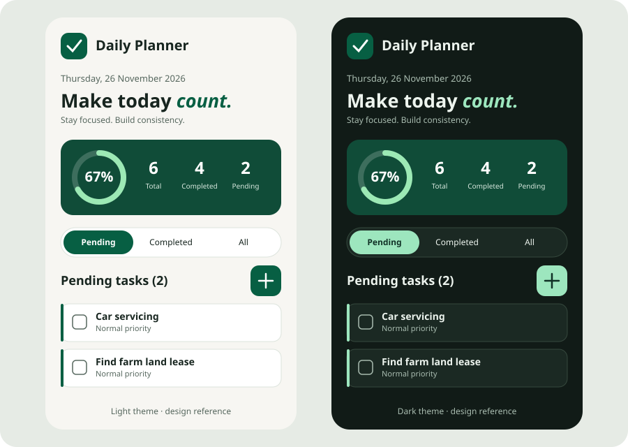

# Daily Planner

A single-user, mobile-friendly personal checklist for Google Chrome. Hosted on GitHub Pages; no backend or account required.

[Open planner](https://varunjakkampudi-tech.github.io/daily-checklist/) · [CI](https://github.com/varunjakkampudi-tech/daily-checklist/actions) · [Architecture](docs/architecture.md) · [Verification](docs/verification.md) · [Security](SECURITY.md)




*Design reference, not a captured browser screenshot.*

## Features

- Today's local date, cumulative task counts and completion progress.
- Exactly three task tabs: Pending, Completed and All; a header settings shortcut opens appearance and backup controls.
- Completed and All retain access to archived tasks; archived tasks can be reopened.
- Category badges, priorities, notes, recorded completion dates, recurring tasks, editing, deletion and undo.
- Premium cream-and-emerald light theme, charcoal-and-emerald dark theme, automatic local-time appearance, persistent theme toggle, local storage, backup and recovery.
- Offline application shell after a successful online installation.

## Run locally

Use Node.js 22 and Python 3.

```sh
node --test tests/core.test.cjs tests/checklist.test.mjs
npm install --no-save --package-lock=false @playwright/test@1.52.0
npx playwright install --with-deps chromium
npx playwright test --project=chromium
```

Playwright starts its own local server on port 8000. For manual use, run `python3 -m http.server 8000` separately.

## Structure

- `index.html`, `assets/css/main.css`: interface.
- `assets/js/core.js`: validation, migration, merging and recurrence.
- `assets/js/app.js`: browser events, rendering and persistence.
- `tasks.json`: public plan managed externally.
- `sw.js`, `manifest.webmanifest`: offline shell and installation metadata.
- `tests/`, `playwright.config.cjs`, `.github/workflows/`: automated verification.

## Release

GitHub Pages serves main. Require successful checks for the exact release revision, then verify the deployed planner. Bump the shell cache version when updating cached assets. Browser coverage targets Chromium, not Firefox or WebKit.

## Data and privacy

The public repository and plan are visible to others. Keep sensitive tasks and notes in local browser storage; export backups regularly. No authentication, encryption or cross-device synchronization is provided. Clearing browser data can remove local tasks. See the security documentation.

No production certification is implied by this README.
