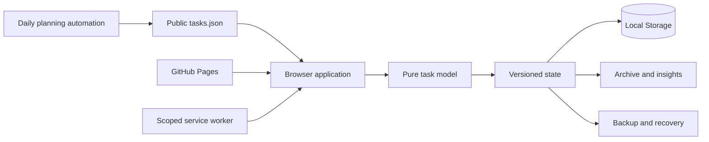

# Daily Planner

A mobile-first, local-first personal productivity workspace deployed as a static web application on GitHub Pages.

   [](https://github.com/varunjakkampudi-tech/daily-checklist/actions/workflows/ci.yml)

[Live application](https://varunjakkampudi-tech.github.io/daily-checklist/) · [Architecture](docs/architecture.md) · [Verification](docs/verification.md) · [Security](SECURITY.md) · [Changelog](CHANGELOG.md)


*Design illustration, not a captured browser screenshot.*

## Product scope

| Domain | Capability |
| --- | --- |
| Today | Categorized tasks, priority, progress, completion and undo |
| Lifecycle | Carry-forward, archive, restore, defer and resume |
| Planning | Custom categories, notes, completion-relative daily and weekly recurrence |
| Insights | Completion counts over 1, 7 and 30 days; category breakdown; completion-day streak |
| Appearance | Automatic local-time appearance, light and dark preferences, reduced-motion feedback |
| Portability | Versioned backup, validated restore, legacy import and recovery export |
| Delivery | Public JSON plan, installable manifest, scoped offline shell |

No backend, database, authentication or cross-device synchronization is in scope. Public task descriptions must be non-sensitive. Private edits, notes and completion state stay in browser storage. Dates are not displayed on the primary checklist.

## Architecture



The state envelope contains active tasks, archive and previously seen identifiers. The client merges unseen plan IDs, preserves local edits, and archives completed tasks after the local day changes. Recurrence is completion-relative, not a calendar alarm. Missed occurrences do not create a backlog. See the architecture document for constraints and failure handling.

## Repository layout

```text
index.html
manifest.webmanifest
sw.js
tasks.json
tasks.example.json
assets/
  logo.svg
  focus.svg
  css/main.css
  js/core.js
  js/app.js
tests/
  core.test.cjs
  browser/planner.spec.cjs
playwright.config.cjs
.github/workflows/ci.yml
docs/
  architecture.md
  verification.md
  assets/dashboard.svg
README.md
SECURITY.md
CHANGELOG.md
```

## Development

```bash
python3 -m http.server 8000
node --test tests/core.test.cjs
npm install --no-save --package-lock=false @playwright/test@1.52.0
npx playwright install --with-deps
npx playwright test
```

Run the browser suite with port 8000 free; its configuration starts a local server. Runtime dependencies are not required.

## Deployment

GitHub Pages serves the root of main. The service worker uses a versioned, scope-restricted application shell; the task manifest remains network-only. Bump the shell cache version when changing cached application assets. Reopen the application after a deployment and verify task loading, completion, reload and offline behavior.

## Verification status

Data-model assertions have been exercised during development. Node and three-engine Playwright quality gates are configured; consult actual workflow results for the current revision. Physical iPhone testing, Lighthouse measurements, WCAG assessment and deployment acceptance are not claimed without evidence.

## Security

The application does not encrypt local storage or synchronize it across devices. Export a backup periodically. The public Git repository must never contain private notes, employer information or financial records. See SECURITY.md.

## Maintainer

[Repository owner](https://github.com/varunjakkampudi-tech). No open-source license has been selected.
