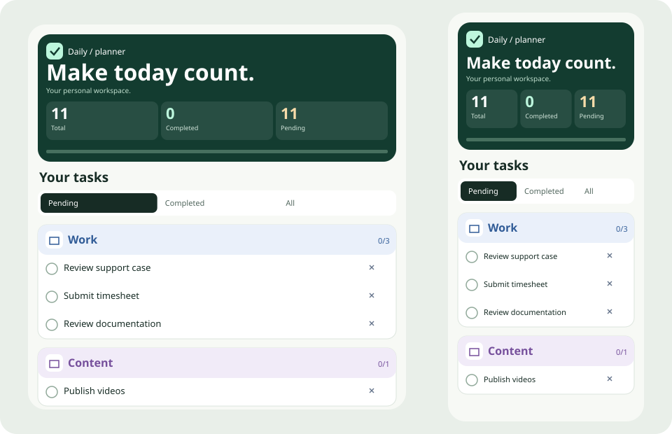
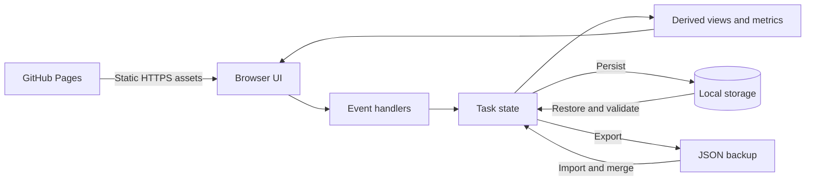
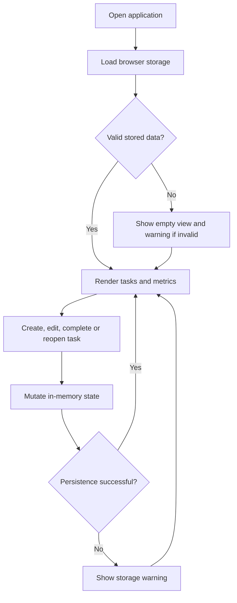

# Daily Checklist

**A mobile-first personal task management and productivity dashboard.**


[Application](https://varunjakkampudi-tech.github.io/daily-checklist/) · [Architecture](docs/architecture.md) · [Verification](docs/verification.md) · [Security](SECURITY.md)



*Design illustration using synthetic data; not a captured runtime screenshot.*

## Overview

Daily Checklist consolidates professional, personal and business activities into a single mobile-oriented workspace. The application provides task lifecycle management, categorized prioritization and derived completion metrics without a server dependency.

The current delivery is a static, browser-local implementation. Authenticated synchronization and automated daily planning are separate, planned capabilities.

## Functional scope

| Domain | Capability | Implementation |
| --- | --- | --- |
| Task management | Create, edit, complete, reopen and delete | Implemented |
| Organization | Category grouping and priority ordering | Implemented |
| Analytics | Total, pending, completed and completion percentage | Implemented |
| Presentation | Responsive layout and theme selection | Implemented |
| Persistence | Local storage and restoration | Implemented |
| Portability | Validated JSON import and export | Implemented |
| Daily planning | Automated private task delivery | Planned |
| Synchronization | Authenticated cross-device persistence | Planned |

Implementation labels describe source availability, not independently verified production acceptance.

## System architecture



The presentation, validation, task state and persistence logic are colocated in the standalone frontend. These are logical responsibilities rather than independently deployed services. See the [architecture document](docs/architecture.md) for design decisions, data lifecycle, risks and the proposed future architecture.

## Application workflow



## Technology stack

| Layer | Technology |
| --- | --- |
| Presentation | Semantic HTML, responsive CSS |
| Application | Native JavaScript and DOM APIs |
| Persistence | Web Storage API |
| Identifiers | Web Crypto API |
| Data exchange | JSON and browser File/Blob APIs |
| Hosting | GitHub Pages |
| Version control | Git and GitHub |

No runtime packages, external fonts, analytics services or build step are required.

## Data model

| Field | Type | Constraint |
| --- | --- | --- |
| id | string | Unique within the collection |
| title | string | Non-blank, maximum 240 characters |
| category | enum | Work, Content, Personal, Finance, Business, Other |
| priority | enum | High, Normal, Low |
| done | boolean | Completion state |

The collection is limited to 500 tasks. Import rejects duplicate IDs and preserves existing records when identifiers match. Refer to [example data](tasks.example.json) for the import format.

## Repository layout

```text
daily-checklist/
├── index.html
├── tasks.example.json
├── .nojekyll
├── README.md
├── SECURITY.md
└── docs/
    ├── architecture.md
    ├── verification.md
    └── assets/
        └── dashboard.svg
```

## Local development

Prerequisites: Git, Python 3 (or another static HTTP server), and a modern browser.

```bash
git clone https://github.com/varunjakkampudi-tech/daily-checklist.git
cd daily-checklist
python -m http.server 8000
```

Open http://localhost:8000. No dependency installation is necessary. Localhost or HTTPS is recommended for the Web Crypto API.

## Deployment and operations

The deployment target is GitHub Pages using the root of the main branch. The .nojekyll marker enables direct static asset serving. Repository administrators configure Pages under Settings → Pages.

Validate the deployed application after each release: load the site, confirm asset availability, perform a task lifecycle operation and reload to verify persistence. Roll back defective changes by reverting the relevant Git commit and verifying the resulting deployment.

## Quality and verification

The [verification plan](docs/verification.md) defines functional, persistence, import, responsive and accessibility acceptance criteria. Automated regression tests, measured performance and device-specific acceptance are not yet established.

## Security and privacy

The repository and hosted frontend are public. Personal checklists, employer data and credentials must never be committed. Browser local storage is not encrypted by the application and is not an authenticated data store. JSON backups contain readable task data. See [security policy](SECURITY.md).

## Engineering roadmap

| Phase | Deliverable | Status |
| --- | --- | --- |
| 1 | Static frontend and browser-local task lifecycle | Implemented; acceptance pending |
| 2 | Modular source, automated tests and CI | Planned |
| 3 | Authenticated private API and task database | Planned |
| 4 | Daily AI planning, carry-forward and reconciliation | Planned |
| 5 | Cross-device synchronization and operational monitoring | Planned |

No planned capability is represented as currently operational.

## Maintainer

[Repository owner](https://github.com/varunjakkampudi-tech). No open-source license has been selected; public visibility alone does not grant reuse rights.
