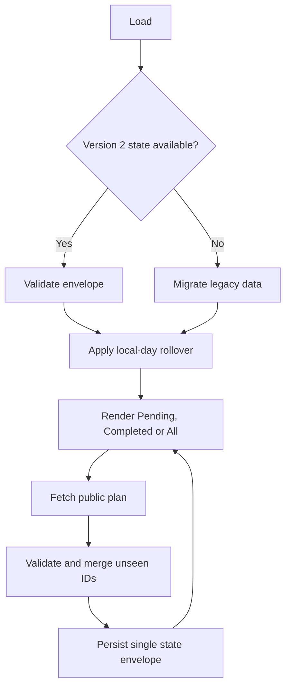
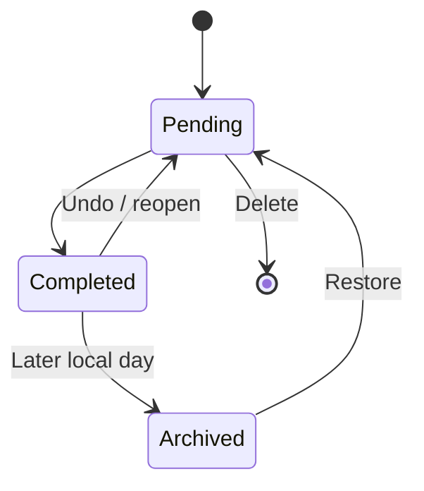

# Architecture

## Scope and responsibilities

A static HTML shell, consolidated stylesheet, pure task model (core.js), browser controller (app.js), public task manifest and a scoped service worker. No backend or database. The controller owns rendering, user events, persistence and refresh. The model validates and normalizes records, migrates legacy data, merges plans and performs rollover.

## Data contract

State key daily-checklist:v2 contains version, tasks, archive and seen. Legacy daily-checklist:v1 and its seen key are retained. Appearance is a separate preference. Task fields: id, title, category, priority, done, completedDay, notes, repeat, optional seriesId and legacy deferred. Public plan accepts legacy records without optional fields. IDs are stable, unique and limited to 240 characters; title 240, category 40, notes 1000. Active capacity 500; archive validation capacity 50,000. Browser quota may impose a much lower practical limit. No automatic history deletion is performed.

## Lifecycle

Unfinished tasks remain active. Daily and weekly recurrence creates one new occurrence after completion and its due interval; an existing active occurrence suppresses duplicates. Recurrence does not backfill missed days. Archived records remain visible under Completed and All. Legacy deferred records remain pending; the deferred field is retained for backup compatibility.

## Reliability

The state envelope is saved in one localStorage write. Corrupt state blocks ordinary persistence; recovery export exposes raw stored values to the owner. Full restore requires confirmation and preserves the prior v2 raw value in a recovery key when storage permits. Legacy array imports merge unseen IDs. Refresh never removes local tasks. Published notes may fill empty notes on matching active or archived task IDs; existing nonempty notes, titles and completion states are preserved. Seen IDs suppress re-import of deleted or completed plan items; an empty Pending view does not necessarily mean the public plan is missing. Storage events adopt external valid state; a pre-write comparison detects stale snapshots, but localStorage lacks atomic compare-and-swap and simultaneous writes can still race. Separate devices are not synchronized.

## Offline and delivery

The worker caches a versioned static shell on installation, refreshes cached assets on successful fetches and removes only its own old caches. The task manifest is deliberately network-only. Embedded starter data is used for a new local state. Offline access requires a successful prior shell installation. No push or background task execution is promised. New plan publication is external to the browser; automation cannot observe local completion.

## Trade-offs

The app is intended for one person using one device. Browser storage is not encrypted or guaranteed durable; export regularly. Data recovery, simultaneous-tab writes, quota exhaustion, mobile installation and service-worker upgrades require browser acceptance testing. No formal accessibility or performance conformance is claimed.
