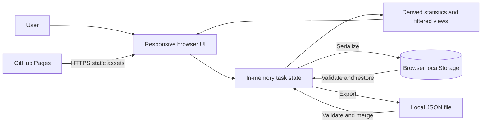
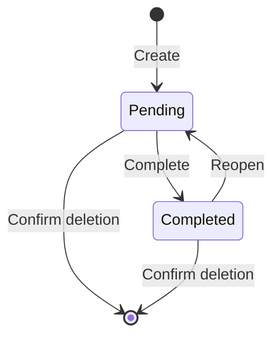
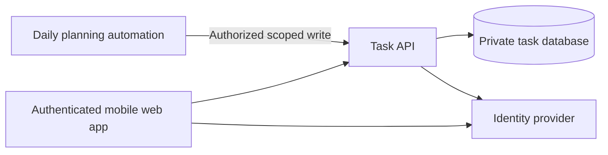

# Architecture and engineering decisions

## Current architecture

The application is a dependency-free static frontend. The presentation, event handlers, validation and persistence adapter reside in index.html; they are logical responsibilities, not independent deployed services.

## Architectural decisions

| Decision | Rationale | Trade-off |
| --- | --- | --- |
| Static hosting | Minimal infrastructure and deployment complexity | No server-side authentication or scheduling |
| Native browser APIs | No runtime package dependencies or build step | Manual maintenance of state and DOM rendering |
| Browser-local persistence | Avoid transmitting personal tasks to a backend | Device-specific data, not encrypted; storage can be cleared |
| Stable task identifiers | Deterministic import deduplication | Existing matching IDs are retained rather than overwritten |
| Derived counters | Avoid maintaining inconsistent aggregate state | Recomputed on each render |
| Explicit user import | Keep private task payloads outside public Git history | Manual data transfer |

## Persistence contract

Storage key: `daily-checklist:v1`. Theme preference: `daily-checklist:v1:theme`. Each task contains an ID, title, category, priority and Boolean completion state. New IDs are generated with crypto.randomUUID(), requiring a supported secure browser context. Import accepts up to 500 tasks and a file of at most 1,000,000 bytes. Titles must contain non-whitespace content and be at most 240 characters. Duplicate IDs in an imported file are rejected; existing IDs take precedence during merge. No schema migration, timestamp, audit log or daily rollover exists yet.

## Task state machine

## Optional alternative architecture (out of current scope)

No database or backend is planned for the current static scope. If the scope changes, define identity, authorization, data retention, task reconciliation, idempotency, API contract and operational budget. Never expose credentials or private task data in public static assets. Daily scheduling must preserve unfinished tasks and avoid asserting completion without evidence.

## Known risks

Browser storage failures currently leave changes in memory and display a warning. Invalid stored data falls back to an empty view; recovery behavior requires testing. Concurrent tabs and devices are not reconciled. Browser-level accessibility, mobile compatibility, and deployed-site acceptance have not been established.

## Static plan delivery

The application fetches public tasks.json on startup and manual refresh. It appends unseen IDs without overriding local edits, completion or deleted-task markers. The seen-ID registry is stored under daily-checklist:v1:seen. Plan removals do not delete local records. A recurring activity requires a new ID for each distinct occurrence. The public plan must contain only approved public-safe descriptions. Daily automation cannot observe browser-local completion state. No database is required.
